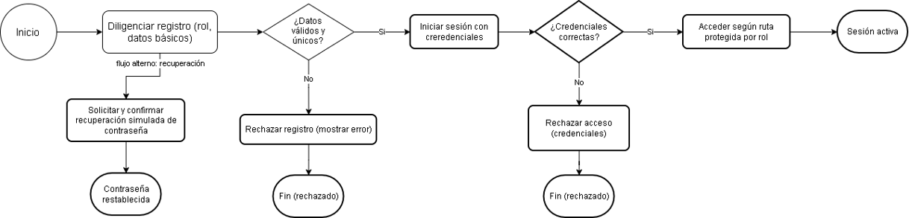
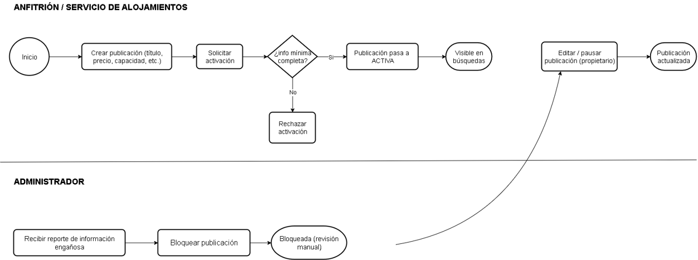
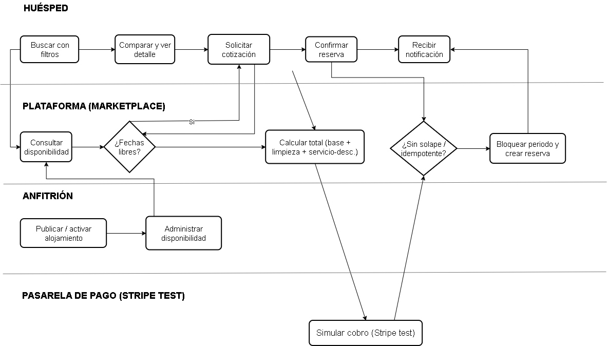
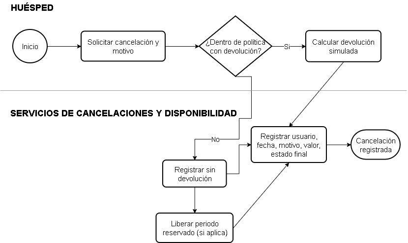
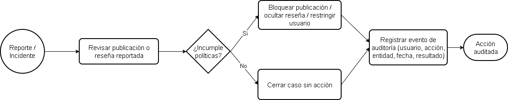

# 4. Procesos de negocio

A partir del contexto y las situaciones descritas se seleccionaron los procesos críticos que generan valor en el marketplace. Para cada uno se documentan límites, participantes, entradas, salidas, reglas de negocio aplicables y resultado esperado.

## P-01 Registro y autenticación de usuarios

| Atributo | Detalle |
|---|---|
| Límites del proceso | Desde el registro/solicitud de acceso hasta la emisión de sesión autorizada o recuperación de contraseña. |
| Participantes | Huésped, Anfitrión, Administrador, Servicio de Identidad y Perfil. |
| Entradas | Datos de registro, credenciales, solicitud de recuperación. |
| Salidas | Cuenta creada, sesión autenticada, contraseña restablecida (simulada). |
| Reglas de negocio aplicables | Roles HUÉSPED/ANFITRIÓN/ADMINISTRADOR; rutas protegidas por rol. |
| Resultado esperado | Usuario habilitado para operar según su rol. |

Diagrama BPMN

## P-02 Publicación y administración de alojamientos

| Atributo | Detalle |
|---|---|
| Límites del proceso | Desde la creación de un borrador de publicación hasta su activación, pausa o bloqueo. |
| Participantes | Anfitrión, Administrador, Servicio de Alojamientos. |
| Entradas | Título, descripción, ubicación, tipo, capacidad, precio, servicios, reglas, imágenes. |
| Salidas | Publicación en estado ACTIVA/PAUSADA/BLOQUEADA. |
| Reglas de negocio aplicables | RN-01, RN-02, RN-03, RN-05, RN-06. |
| Resultado esperado | Publicación disponible (o no) para búsqueda. |

Diagrama BPMN

## P-03 Publicación → Búsqueda → Cotización → Reserva Inmediata

| Atributo | Detalle |
|---|---|
| Límites del proceso | Desde la búsqueda del huésped hasta la creación de la reserva y su notificación. |
| Participantes | Huésped, Anfitrión (disponibilidad), Servicio de Búsqueda, Disponibilidad, Cotización, Reservas, Stripe (test). |
| Entradas | Criterios de búsqueda, fechas, servicios adicionales seleccionados. |
| Salidas | Reserva confirmada, cotización calculada, notificación emitida. |
| Reglas de negocio aplicables | RN-04, RN-07, RN-08, RN-09, RN-10, RN-13, RN-16. |
| Resultado esperado | Reserva registrada sin solapamiento y periodo bloqueado. |

Diagrama BPMN

## P-04 Cancelación y aplicación de política

| Atributo | Detalle |
|---|---|
| Límites del proceso | Desde la solicitud de cancelación hasta la liberación del periodo y registro del resultado. |
| Participantes | Huésped, Anfitrión, Servicio de Cancelaciones, Servicio de Disponibilidad. |
| Entradas | Reserva a cancelar, motivo. |
| Salidas | Cancelación registrada, periodo liberado (si aplica), devolución simulada calculada. |
| Reglas de negocio aplicables | RN-11, RN-12. |
| Resultado esperado | Reserva en estado CANCELADA con evidencia completa. |

Diagrama BPMN

## P-05 Moderación, soporte y auditoría

| Atributo | Detalle |
|---|---|
| Límites del proceso | Desde la detección/reporte de una irregularidad hasta la acción administrativa y su registro. |
| Participantes | Administrador, Servicio de Administración/Auditoría, Servicio de Reseñas. |
| Entradas | Publicaciones o reseñas reportadas, eventos del sistema. |
| Salidas | Publicación bloqueada, usuario restringido, reseña oculta, evento de auditoría. |
| Reglas de negocio aplicables | RN-14, RN-15, RN-19. |
| Resultado esperado | Registro trazable de la decisión administrativa. |

Diagrama BPMN

