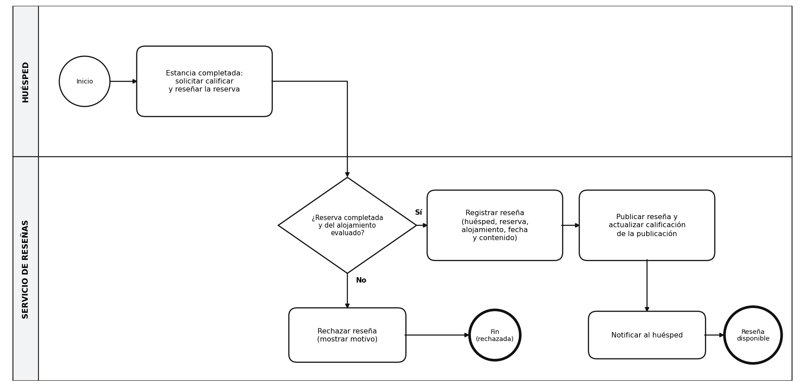
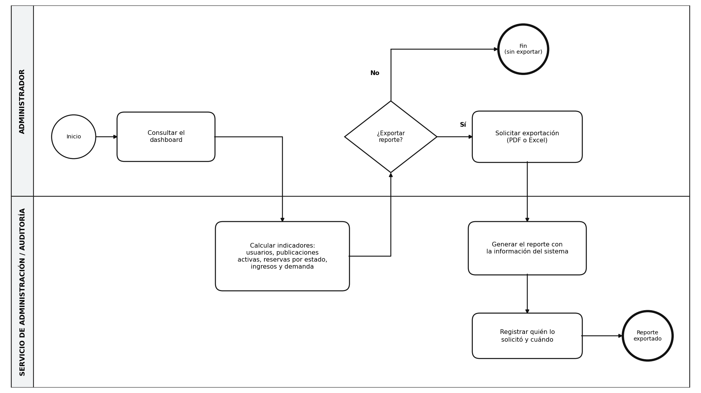

# 4. Procesos de negocio

A partir del contexto y las situaciones descritas se seleccionaron los procesos críticos que generan valor en el marketplace. Para cada uno se documentan límites, participantes, entradas, salidas, reglas de negocio aplicables y resultado esperado.

## P-01 Registro y autenticación de usuarios

| Atributo | Detalle |
|---|---|
| Límites del proceso | Desde el registro/solicitud de acceso hasta la emisión de sesión autorizada o recuperación de contraseña. |
| Participantes | Huésped, Anfitrión, Administrador, Servicio de Identidad y Perfil. |
| Entradas | Datos de registro, credenciales, solicitud de recuperación. |
| Salidas | Cuenta creada, sesión autenticada, contraseña restablecida (simulada). |
| Reglas de negocio aplicables | Roles HUÉSPED/ANFITRIÓN/ADMINISTRADOR; rutas protegidas por rol. |
| Resultado esperado | Usuario habilitado para operar según su rol. |

Diagrama BPMN

## P-02 Publicación y administración de alojamientos

| Atributo | Detalle |
|---|---|
| Límites del proceso | Desde la creación de un borrador de publicación hasta su activación, pausa o bloqueo. |
| Participantes | Anfitrión, Administrador, Servicio de Alojamientos. |
| Entradas | Título, descripción, ubicación, tipo, capacidad, precio, servicios, reglas, imágenes. |
| Salidas | Publicación en estado ACTIVA/PAUSADA/BLOQUEADA. |
| Reglas de negocio aplicables | RN-01, RN-02, RN-03, RN-05, RN-06. |
| Resultado esperado | Publicación disponible (o no) para búsqueda. |

Diagrama BPMN

## P-03 Publicación → Búsqueda → Cotización → Reserva Inmediata

| Atributo | Detalle |
|---|---|
| Límites del proceso | Desde la búsqueda del huésped hasta la creación de la reserva y su notificación. |
| Participantes | Huésped, Anfitrión (disponibilidad), Servicio de Búsqueda, Disponibilidad, Cotización, Reservas, Stripe (test). |
| Entradas | Criterios de búsqueda, fechas, servicios adicionales seleccionados. |
| Salidas | Reserva confirmada, cotización calculada, notificación emitida. |
| Reglas de negocio aplicables | RN-04, RN-07, RN-08, RN-09, RN-10, RN-13, RN-16. |
| Resultado esperado | Reserva registrada sin solapamiento y periodo bloqueado. |

Diagrama BPMN

## P-04 Cancelación y aplicación de política

| Atributo | Detalle |
|---|---|
| Límites del proceso | Desde la solicitud de cancelación hasta la liberación del periodo y registro del resultado. |
| Participantes | Huésped, Anfitrión, Servicio de Cancelaciones, Servicio de Disponibilidad. |
| Entradas | Reserva a cancelar, motivo. |
| Salidas | Cancelación registrada, periodo liberado (si aplica), devolución simulada calculada. |
| Reglas de negocio aplicables | RN-11, RN-12. |
| Resultado esperado | Reserva en estado CANCELADA con evidencia completa. |

Diagrama BPMN

## P-05 Moderación, soporte y auditoría

| Atributo | Detalle |
|---|---|
| Límites del proceso | Desde la detección/reporte de una irregularidad hasta la acción administrativa y su registro. |
| Participantes | Administrador, Servicio de Administración/Auditoría, Servicio de Reseñas. |
| Entradas | Publicaciones o reseñas reportadas, eventos del sistema. |
| Salidas | Publicación bloqueada, usuario restringido, reseña oculta, evento de auditoría. |
| Reglas de negocio aplicables | RN-14, RN-15, RN-19. |
| Resultado esperado | Registro trazable de la decisión administrativa. |

Diagrama BPMN

## P-06 Reseñas y calificaciones

| Atributo | Detalle |
|---|---|
| Límites del proceso | Desde que el huésped completa su estancia y solicita calificar hasta que la reseña queda publicada (o rechazada) y disponible para consulta en la publicación. |
| Participantes | Huésped, Servicio de Reseñas. La moderación posterior la hace el Administrador (ver P-05). |
| Entradas | Reserva completada, calificación y texto de la reseña. |
| Salidas | Reseña registrada y publicada, calificación de la publicación actualizada y notificación al huésped. |
| Reglas de negocio aplicables | RN-17, RN-18. |
| Resultado esperado | Reseña trazable que conserva la relación huésped, reserva, alojamiento, fecha y contenido. |

Diagrama BPMN

## P-07 Dashboard y exportación de reportes

| Atributo | Detalle |
|---|---|
| Límites del proceso | Desde que el administrador consulta el dashboard hasta que obtiene el reporte exportado y queda registrada la solicitud. |
| Participantes | Administrador (incluye al área de operación y auditoría), Servicio de Administración/Auditoría. |
| Entradas | Solicitud de consulta del dashboard, tipo de información del reporte y formato (PDF o Excel). |
| Salidas | Indicadores del dashboard, archivo exportado y registro de quién lo solicitó y cuándo. |
| Reglas de negocio aplicables | RN-15, RN-20. |
| Resultado esperado | Reporte coherente con la información disponible en el sistema y con registro de la solicitud. |

Diagrama BPMN

## Cobertura de los procesos pedidos en el enunciado

El enunciado pide analizar estos procesos. La tabla muestra en cuál de los modelos queda cubierto cada uno.

| Proceso del enunciado | Dónde se modela |
|---|---|
| Incorporación y gestión de usuarios | P-01 |
| Publicación, revisión y administración de alojamientos | P-02 |
| Mantenimiento de precios, servicios, reglas e imágenes | P-02 (edición de la publicación por su propietario) |
| Administración y consulta de disponibilidad | P-03 (carril del anfitrión) y P-04 (liberación del periodo) |
| Descubrimiento, comparación y selección de alojamientos | P-03 |
| Cotización y confirmación de reservas | P-03 |
| Cancelación y aplicación de políticas | P-04 |
| Notificaciones y seguimiento de estados | P-03 (notificación de la reserva), P-04 (cancelación) y P-06 (reseña) |
| Moderación, soporte y auditoría | P-05 |
| Consulta y exportación de información para la gestión | P-07 |
| Reseñas y calificaciones (parte del alcance del MVP) | P-06 |
| Evolución de reglas y capacidades del negocio | No se modela como proceso: se resuelve con parámetros configurables (RN-09, porcentajes de tarifas; RN-10, modo de reserva). Por confirmar con el equipo. |

## Trazabilidad de los procesos

Cada proceso se relaciona con las reglas de negocio (página 5), las historias de usuario y las épicas (página 6).

| Proceso | Reglas de negocio | Historias de usuario | Épicas |
|---|---|---|---|
| P-01 Registro y autenticación de usuarios | Roles y rutas protegidas | HU-01, HU-02, HU-03, HU-04 (HU-05 y HU-06 para la gestión de la cuenta) | EP-01 |
| P-02 Publicación y administración de alojamientos | RN-01, RN-02, RN-03, RN-05, RN-06 | HU-07, HU-08, HU-09, HU-10 | EP-02 |
| P-03 Publicación, búsqueda, cotización y reserva inmediata | RN-04, RN-07, RN-08, RN-09, RN-10, RN-13, RN-16 | HU-11, HU-12, HU-13, HU-14, HU-15, HU-16, HU-17, HU-18, HU-20 | EP-02, EP-03, EP-04, EP-05, EP-06 |
| P-04 Cancelación y aplicación de política | RN-11, RN-12 | HU-19, HU-20 | EP-06 |
| P-05 Moderación, soporte y auditoría | RN-14, RN-15, RN-19 | HU-10, HU-23, HU-24, HU-25 | EP-02, EP-07, EP-08 |
| P-06 Reseñas y calificaciones | RN-17, RN-18 | HU-21, HU-22 | EP-07 |
| P-07 Dashboard y exportación de reportes | RN-15, RN-20 | HU-26, HU-27 | EP-09 |
