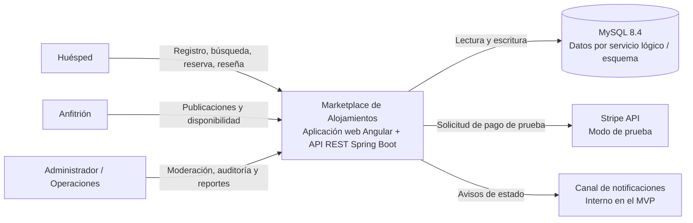
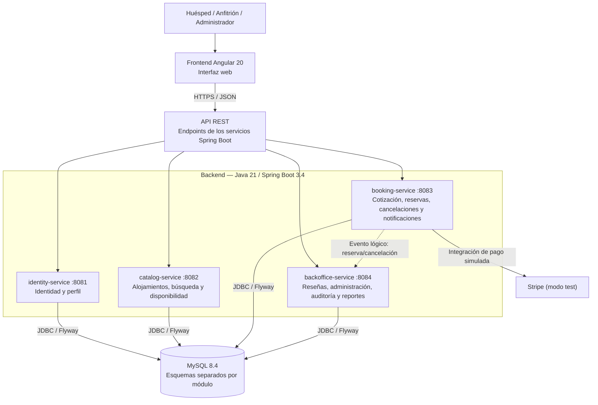

# SCRUM-46 — Arquitectura orientada a servicios (C4)

## 1. Objetivo y alcance

Este documento define la vista de contexto, la vista de contenedores y la descomposición lógica de los servicios del Marketplace de Alojamientos. La arquitectura se diseña para los procesos P-01 a P-07 y las historias HU-01 a HU-27 descritas en la documentación funcional.

**Decisión de arquitectura:** el dominio se divide en **12 servicios lógicos**, agrupados por ahora en **4 aplicaciones backend desplegables**. Un servicio lógico representa una responsabilidad de negocio; no implica necesariamente un proceso o despliegue independiente en el estado actual del repositorio. Esta distinción mantiene coherencia con el monorepo existente y permite separar los servicios físicamente más adelante si el proyecto lo requiere.

## 2. C4 — Nivel 1: contexto del sistema

El Marketplace permite a huéspedes buscar y reservar alojamientos, a anfitriones administrar sus publicaciones y disponibilidad, y a administradores moderar la operación y consultar reportes. El sistema usa MySQL para persistencia y Stripe en modo de prueba para simular pagos.

### Actores y sistemas externos

| Elemento | Responsabilidad / interacción |
|---|---|
| Huésped | Registrarse, buscar alojamientos, cotizar, reservar, cancelar y reseñar estancias completadas. |
| Anfitrión | Crear y administrar publicaciones, precios, reglas y periodos disponibles. |
| Administrador / Operaciones | Moderar publicaciones y reseñas, restringir usuarios, consultar auditoría y reportes. |
| MySQL 8.4 | Persistencia relacional del MVP. El repositorio configura cuatro bases/esquemas para los módulos backend. |
| Stripe (test) | Proveedor externo para simular el flujo de pago; no se procesan pagos reales. |
| Notificaciones | En el MVP se representan como capacidad interna; no se presupone una integración real con correo o SMS. |

## 3. C4 — Nivel 2: contenedores

**Nota de implementación:** el diagrama representa los contenedores de software y sus responsabilidades actuales. El enlace punteado de eventos representa una dependencia lógica del dominio (por ejemplo, para auditoría); no afirma que exista un broker de mensajería configurado. En el estado actual, los servicios tienen contratos HTTP y persistencia en sus respectivos módulos; la integración entre módulos debe confirmarse contra la implementación antes de presentarla como terminada.

## 4. Descomposición de los 12 servicios lógicos

| # | Servicio lógico | Responsabilidad principal | Datos bajo su responsabilidad | Módulo desplegable actual |
|---:|---|---|---|---|
| 1 | Identidad y perfil | Registro, autenticación, roles, sesión, recuperación simulada y perfil. | Usuarios, credenciales cifradas, roles y perfiles. | `identity-service` |
| 2 | Alojamientos | Crear, editar, activar, pausar y bloquear publicaciones. | Publicaciones, características, imágenes y reglas. | `catalog-service` |
| 3 | Disponibilidad | Administrar periodos disponibles y evitar solapamientos; bloquear periodos reservados y liberarlos cuando corresponda. | Periodos y bloqueos de disponibilidad. | `catalog-service` |
| 4 | Búsqueda | Filtrar y presentar alojamientos activos según criterios del huésped; apoyar la comparación. | En el MVP consulta el catálogo; no requiere un almacén propio de búsqueda. | `catalog-service` |
| 5 | Cotización | Calcular precio base, limpieza, tarifa de servicio y extras; entregar desglose y total. | Cotizaciones y desglose de valores. | `booking-service` |
| 6 | Reservas | Confirmar reservas, consultar estados e historial, aplicar idempotencia y coordinar el flujo de pago de prueba. | Reservas y estados de reserva. | `booking-service` |
| 7 | Cancelaciones | Aplicar la política de cancelación, registrar motivo y devolución simulada, y coordinar la liberación de disponibilidad. | Solicitudes y resultados de cancelación. | `booking-service` |
| 8 | Notificaciones | Registrar y exponer avisos relacionados con reservas, cancelaciones y reseñas. | Notificaciones y estado de lectura, cuando esté implementado. | `booking-service` (agrupación actual) |
| 9 | Reseñas | Validar que la reserva esté completada, registrar calificación y texto, consultar y ocultar reseñas mediante moderación autorizada. | Reseñas, calificaciones y estado de publicación. | `backoffice-service` |
| 10 | Administración | Herramientas de moderación y operación: restringir usuarios y gestionar publicaciones o reseñas reportadas. | Acciones y decisiones administrativas; consulta datos de otros dominios mediante sus interfaces. | `backoffice-service` |
| 11 | Auditoría | Mantener trazabilidad de acciones sensibles y cambios de estado relevantes, con actor y fecha. | Eventos de auditoría inmutables o de solo anexado. | `backoffice-service` |
| 12 | Reportería | Consultar indicadores del negocio y generar exportaciones PDF/Excel, registrando la solicitud. | Definiciones de reportes y registro de exportaciones; agrega datos autorizados de otros servicios. | `backoffice-service` |

### Capacidades externas y transversales

- **Stripe test** es un proveedor externo, no uno de los 12 servicios internos.
- **MySQL, Spring Boot, Angular, JWT y Flyway** son tecnologías/infraestructura, no servicios de negocio.
- La autorización por rol debe verificarse en cada operación protegida, aunque Identidad sea responsable de gestionar usuarios y roles.

## 5. Interacciones principales

### P-03 — Búsqueda, cotización y reserva

1. El huésped consulta el servicio de Búsqueda.
2. Búsqueda obtiene publicaciones activas de Alojamientos y consulta Disponibilidad para las fechas solicitadas.
3. Cotización calcula el desglose del precio y devuelve el total.
4. Reservas vuelve a validar disponibilidad al confirmar para prevenir solapamientos y duplicados.
5. Reservas coordina el pago de prueba con Stripe cuando corresponda, crea la reserva y solicita la notificación.
6. El cambio relevante queda disponible para trazabilidad/auditoría.

### P-04 — Cancelación

1. Cancelaciones recibe la solicitud y consulta la política asociada a la publicación.
2. Calcula el resultado/devolución simulada y registra motivo, actor, fecha y estado.
3. Si aplica, coordina con Disponibilidad la liberación del periodo.
4. Notificaciones informa el resultado y Auditoría conserva la evidencia del cambio.

### P-05 / P-07 — Administración, auditoría y reportes

1. Administración verifica permisos y ejecuta la acción de moderación.
2. El servicio responsable del dominio actualiza el estado; la acción debe quedar trazada en Auditoría.
3. Reportería consulta la información disponible para el usuario autorizado, genera el resultado solicitado y registra quién lo pidió y cuándo.

Estas secuencias son la descripción lógica objetivo; no implican que todos los pasos estén implementados ya en el código.

## 6. Reglas de diseño y límites

- Cada servicio lógico tiene una responsabilidad de negocio identificable y un propietario de datos definido.
- Un servicio no debe modificar directamente las tablas privadas de otro servicio; debe utilizar su interfaz o un contrato acordado.
- Las operaciones críticas de reserva validan de nuevo la disponibilidad en el momento de confirmar.
- La integración de pagos se mantiene en modo de prueba y nunca debe almacenar datos de tarjeta.
- Los eventos de auditoría deben incluir como mínimo actor, acción, recurso, fecha/hora y resultado cuando aplique.
- La agrupación actual en cuatro aplicaciones es una decisión pragmática para el MVP, no una afirmación de que los 12 servicios ya sean microservicios independientes.

## 7. Trazabilidad funcional

| Proceso | Servicios principales |
|---|---|
| P-01 Registro y autenticación | Identidad y perfil |
| P-02 Publicación y administración de alojamientos | Alojamientos, Identidad, Administración, Auditoría |
| P-03 Búsqueda, cotización y reserva | Búsqueda, Alojamientos, Disponibilidad, Cotización, Reservas, Notificaciones, Auditoría |
| P-04 Cancelación | Cancelaciones, Disponibilidad, Notificaciones, Auditoría |
| P-05 Moderación, soporte y auditoría | Administración, Reseñas, Identidad, Auditoría |
| P-06 Reseñas y calificaciones | Reseñas, Reservas, Notificaciones |
| P-07 Dashboard y exportación | Reportería, Auditoría |

## 8. Estado y pendientes de validación

- [x] Documentar contexto y actores externos.
- [x] Documentar contenedores actuales del repositorio.
- [x] Definir 12 servicios lógicos, responsabilidades y agrupación desplegable.
- [x] Relacionar servicios con procesos del negocio.
- [ ] Validar con el equipo los límites definitivos y la nomenclatura de los 12 servicios en Jira.
- [ ] Contrastar cada interacción con los endpoints y pruebas reales antes de afirmar que está implementada.
- [ ] Adjuntar captura del diagrama o evidencia de revisión en Jira.

## 9. Criterio de aceptación del SCRUM-46

Se considera documentado cuando existen vistas C4 de contexto y contenedores, los 12 servicios tienen responsabilidad definida, se muestran dependencias e integraciones externas y la documentación distingue claramente la arquitectura lógica del despliegue real del repositorio.
